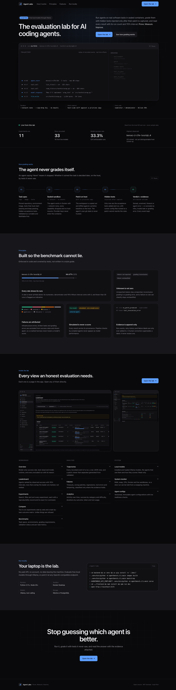
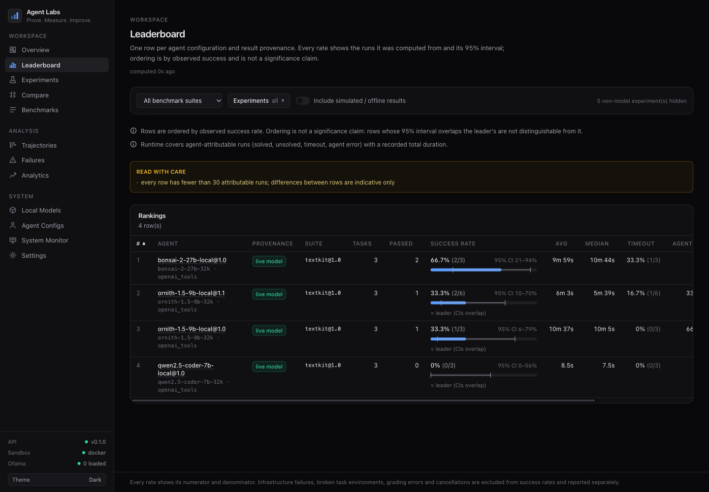
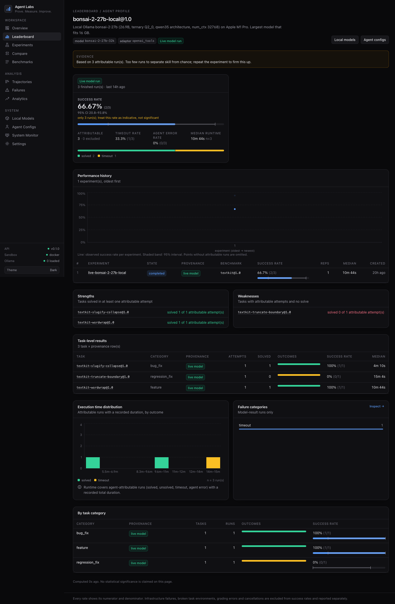
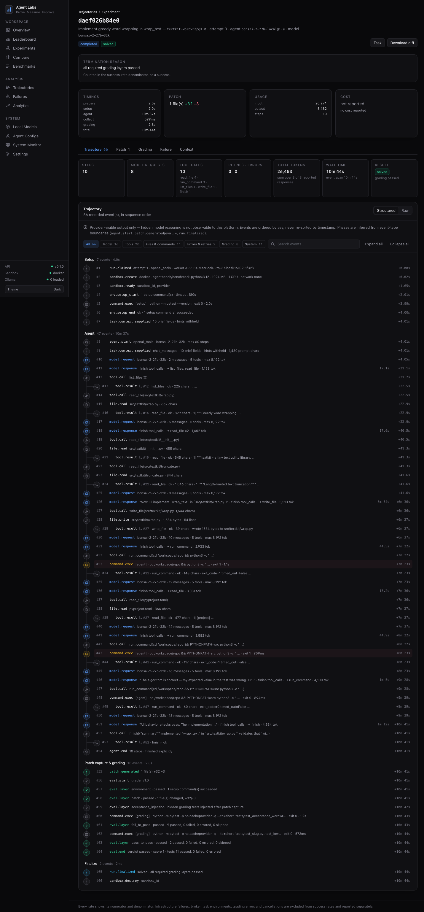
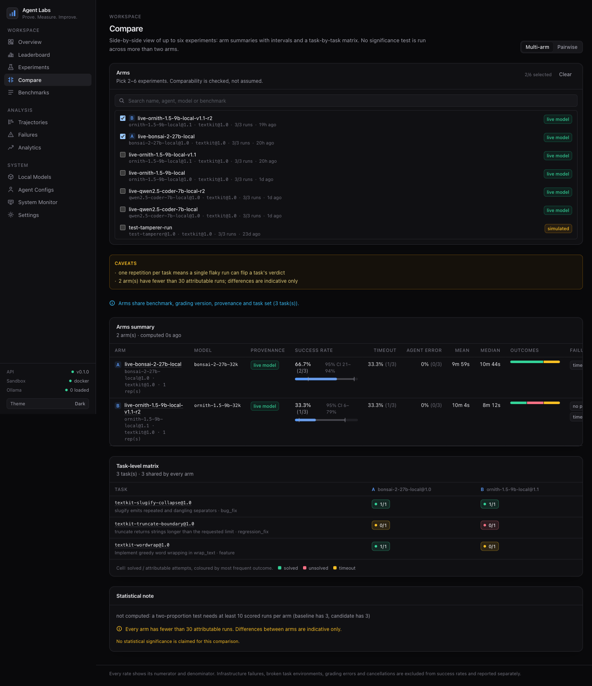
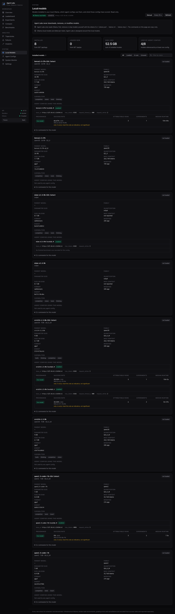
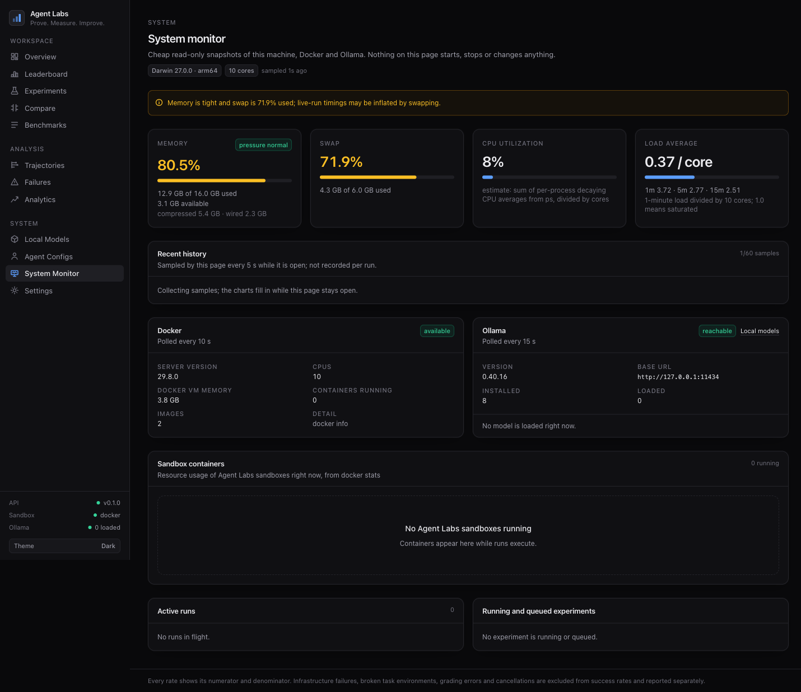

# Agent Labs

**Prove. Measure. Improve.**

An open, local-first laboratory for evaluating coding agents through real
execution, reproducible experiments, and evidence-driven benchmarking.

Give it a benchmark of real software-engineering tasks and an agent, and it will
run the agent in an isolated container, grade the result with tests the agent
never sees, record everything it observably did, and tell you *why* it failed —
distinguishing a wrong patch from a crashed harness from a dead Docker daemon.
It runs free local models through Ollama on a laptop; no paid API is required.

The design premise is **evidence over assertion**. An agent never reports its
own success, every rate carries its denominator, and a number that cannot be
computed honestly is reported as missing rather than guessed.



> The Python package and CLI keep their original name, `agentbench`.

---

## Quick start

Requirements: Python 3.11+, Docker, Node 20+.

```bash
# 1. Backend
cd backend
uv venv && uv pip install -e '.[dev]'      # or: python -m venv .venv && pip install -e '.[dev]'

# 2. Build the benchmark execution image (needs network; benchmark runs do not)
.venv/bin/python -m agentbench.cli.main images build

# 3. Create the schema, import the bundled benchmark and the demo agents
.venv/bin/python -m agentbench.cli.main bootstrap

# 4. Prove each task is executable AND falsifiable, in real containers
.venv/bin/python -m agentbench.cli.main benchmark validate

# 5. Run the benchmark with the deterministic reference agent
.venv/bin/python -m agentbench.cli.main experiment create \
    --name demo --agent reference-solution
.venv/bin/python -m agentbench.cli.main experiment run

# 6. Read the result
.venv/bin/python -m agentbench.cli.main experiment report <experiment-id>
```

Then the web UI:

```bash
cd backend && AGENTBENCH_API_PORT=8077 .venv/bin/python -m agentbench.cli.main serve   # API on :8077
cd frontend && npm install && npm run dev                                              # UI on :5173
```

The checked-in `frontend/.env.development` points the UI at
`http://127.0.0.1:8077/api/v1`. To use the default API port (8000) instead,
start `serve` without `AGENTBENCH_API_PORT` and change that file to
`VITE_API_BASE_URL=http://127.0.0.1:8000/api/v1`.

For the Local Models and System Monitor screens, run Docker Desktop and
Ollama (`ollama serve`, or `brew services start ollama` to keep it running).
Both screens only read; `AGENTBENCH_OLLAMA_BASE_URL` changes where Ollama is
looked for (default `http://127.0.0.1:11434`).

Copy `.env.example` to `.env` to configure anything else. It contains
placeholders only; never commit a filled-in copy.

---

## A tour of the app

The UI opens on a home page that explains the product; **Open the lab** leads
into the app, a dark-first sidebar grouped into **Workspace**, **Analysis** and
**System**. Every number on it comes from the API; nothing is hard-coded, and
simulated pipeline checks are labelled and kept out of model headline numbers.

| Screen | What it shows |
| --- | --- |
| **Home** (`/`) | What Agent Labs is, how a run goes from task to verdict, the principles it enforces, live numbers from your own lab (read from the API, never sample data), and a map linking to every feature page. |
| **Overview** (`/overview`) | Experiments, runs, model-only success rate with its interval, highest-observed model (and whether it is distinguishable from the runner-up), runtime, solved / failed / excluded runs, results by provenance, failure distribution, recent runs and experiments. |
| **Leaderboard** | One row per agent config × provenance: tasks attempted and passed, success rate with 95% Wilson interval, mean/median runtime, timeout and agent-error rates. Filter by benchmark suite and experiments; simulated results are hidden unless asked for. Rows whose interval overlaps the leader's are marked "≈ leader". |
| **Model profile** | Performance history with interval band, task-level results, strengths and weaknesses quoted from evidence ("solved 1 of 1 attributable attempt(s)"), runtime histogram, failure categories. |
| **Experiments** | Searchable, filterable, sortable explorer; detail page with results, runs, configuration and a **Reproducibility** tab (seed, versions, config snapshot, CLI command). |
| **Compare** | 2–6 experiments side by side with comparability blockers, caveats, arm summaries and a task × arm outcome matrix; a pairwise mode adds the two-proportion test when there is enough data. |
| **Benchmarks** | Task library with validation status and timeouts; task pages show the spec, environment, grading requirements, baseline validation, run history, failure patterns and patch statistics. |
| **Trajectories** | Every run, and for each run an ordered timeline of recorded events (model requests/responses with token usage, tool calls paired with their results, commands, file reads/writes, retries, errors, grading layers), a raw JSON view, and a patch viewer that separates *generated* from *validated*. |
| **Failures** | Failure buckets (timeouts, incorrect patches, regressions, tool errors, infrastructure, test tampering, grading errors, other) with raw categories visible; unclassified failures stay "unclassified". Drill down to runs. |
| **Analytics** | Daily activity, success by provenance / category / difficulty, duration by outcome, token usage, tool-call failure rates. |
| **Local Models** | Installed and loaded Ollama models, their size, quantization and context, the agent configs that use them, and those configs' results. Read-only: commands to pull/remove/stop are copy-only. |
| **System Monitor** | RAM, swap, CPU, load, memory pressure, Docker daemon and live sandbox-container stats, Ollama, active runs. Unsupported metrics are labelled, not estimated. |

| | |
| --- | --- |
|  |  |
|  |  |
|  |  |

All screenshots, including the light theme and a 390px phone view, are in
`frontend/screenshots/`.

### Reading results

- **Success rate** = solved ÷ *attributable* runs (solved, unsolved, timeout,
  agent error). Infrastructure errors, invalid tasks, grading errors and
  cancellations are excluded and shown separately — they are not agent failures.
- **Every rate shows n.** `66.7% (2/3)` with `95% CI 21–94%` means the true
  rate could plausibly be anywhere in that range. With fewer than 30 runs the UI
  says so; with overlapping intervals it will not call one agent better.
- **Provenance.** `live model` results come from a real model call; `simulated`
  and `offline adapter test` results validate the harness and are never model
  scores.
- **Unknown is not zero.** Unreported tokens or cost show "not reported", and a
  failure no rule could classify stays "unclassified".

---

## What it does

**Benchmark registry.** Versioned task specs with a validated schema: pinned
repository revision, environment image, setup commands, `fail_to_pass` /
`pass_to_pass` test node IDs, hidden acceptance tests, forbidden paths,
resource limits, hints (withheld from the agent by default). Import/export as
JSON or JSONL.

**Task validation.** A task description existing is not evidence that the task
works. `agentbench benchmark validate` builds the real environment and checks
four things reading the spec cannot: the image exists and the repo
materialises; every declared test node is actually collected; every
`fail_to_pass` test **fails** on the pristine repo (falsifiability — otherwise
any agent scores a free success); every `pass_to_pass` test **passes** on it
(otherwise "regression" is indistinguishable from "already broken").

**Isolated execution.** Every run gets a disposable container with
`--network none`, `--cap-drop ALL`, `no-new-privileges`, memory/CPU/pids
limits, a size-capped `tmpfs`, a non-root user, and **no host mounts**.
Timeouts are enforced by killing the container, not just detaching. Teardown
runs in a `finally` block, and orphaned containers are reclaimed at worker
startup.

**Agent adapters.** A provider-independent contract. Four ship:

| Adapter | Real? | What it is |
| --- | --- | --- |
| `openai_tools` | yes | Model-driven agent loop over any OpenAI-compatible chat API. The model call happens on the **host**; its tools execute **in the sandbox**, so tasks keep `network: none` and the provider key never enters the container. |
| `shell_command` | yes | Bridge to an external CLI agent (Aider, Codex CLI, Claude Code, your own script) running inside the sandbox. |
| `scripted` | no | Applies fixed files/commands per task. Pointed at the bundled reference solutions it is a known-good agent — which is what makes an end-to-end `SOLVED` meaningful. |
| `mock` | no | Behaviour-driven test double: solve, no-op, wrong patch, tamper with tests, hang, crash, sandbox fault. |

`scripted` and `mock` are flagged `is_simulated`, and that flag is carried
through the API, the metrics and the UI. Their results validate the pipeline;
they are never presented as model benchmark numbers.

**Layered grading, independent of the agent.**

| Layer | Question | Failure means |
| --- | --- | --- |
| `environment` | Did repository setup succeed? | `INVALID_TASK` — the task is broken |
| `patch` | Is there a diff, and does it avoid `forbidden_paths`? | `UNSOLVED` — nothing done, or tests tampered with |
| `fail_to_pass` | Do the tests defining the task now pass? | `UNSOLVED` — incorrect implementation |
| `pass_to_pass` | Does the rest of the suite still pass? | `UNSOLVED` — regression introduced |
| `static:*` | Optional lint/type gates | `UNSOLVED` if `required`, else advisory |
| `judge` | Optional model review | Never affects the verdict; stored separately |

The hidden acceptance tests are injected **after** the diff has been captured,
and their paths are automatically added to `forbidden_paths`, so an agent can
neither read nor edit the tests that grade it. Per-test results come from
pytest's JUnit XML, not from an exit code, so "ran nothing and exited 0" cannot
look like success.

**Runner configuration is protected independently of the task.** A patch
touching `pytest.ini`, `setup.cfg`, `tox.ini`, `pyproject.toml` or any
`conftest.py` is rejected at the patch layer, and a task cannot opt out. This is
not theoretical: adding `addopts = -p <module>` to any one of those files loads
an agent-authored pytest plugin that replaces every test body, which made a
`SOLVED` verdict obtainable without touching `tests/` at all. All four injection
points were confirmed against real pytest and are now regression-tested. Tasks
that genuinely need dependency changes use `environment.pip_packages` or
`environment.setup_commands`, which run before the agent starts.

**Failure attribution, not a single "failed" bucket.**

```
solved · unsolved · timeout · agent_error   → counted in the success rate
infra_error · invalid_task · grading_error · cancelled   → excluded, reported separately
```

`passed` is `None` when a layer could not conclude, which becomes
`GRADING_ERROR` rather than a false `UNSOLVED`.

**Trajectory recording.** An append-only event stream per run, ordered by a
monotonic `seq` (never by timestamp, which collides): sandbox lifecycle, setup
commands, the task context given to the agent, model request/response metadata,
tool calls and results, file reads/writes, commands and exit codes, harness
context compaction, retries, the patch, every grading layer, termination. Two
deliberate limits: hidden model reasoning is **not** recorded because it is not
observable, and a field that could not be observed is `null` with a sibling
`"<field>_available": false` so "unknown" is distinguishable from "empty".
Payloads pass through secret redaction before storage.

**Metrics with denominators.** Every rate ships `{value, numerator,
denominator, ci_low, ci_high, small_sample, interpretation_warning}`. A zero
denominator is `null`, never `0.0`. Two success rates, both labelled:
`success_rate_attributable` (timeouts and agent errors count as failures) and
`success_rate_graded` (only runs that reached a verdict). `pass@k` is omitted
unless the experiment ran at least `k` repetitions, and names its estimator.
Confidence intervals are Wilson score. A two-proportion z-test appears only
when both arms have ≥10 scored runs, always with
`claims_significance: false`.

**Resumability.** Runs are rows with a `UNIQUE (experiment_id, task_id,
task_version, attempt_index)` idempotency key and a worker **lease**. Launching,
relaunching or resuming only creates what does not exist. A crashed worker's
runs become reclaimable when the lease expires; `resume` will not steal a run
whose lease is still live unless you pass `force`. An infrastructure retry
appends to `run_attempt_history` and never deletes the original failure.

**Failure analysis.** Every failed run gets an evidence-backed classification
(14 categories) citing the grading layers and exit codes it was derived from.
Provenance is explicit: `rule`, `model` or `human`. Human corrections are
appended as superseding rows; raw evidence is never mutated.

---

## The bundled benchmark

`benchmarks/textkit` is a small MIT-licensed Python library **written for this
project**, with three deliberate defects and three tasks over them:

| Task | Category | What it tests |
| --- | --- | --- |
| `textkit-slugify-collapse` | bug_fix | Runs of punctuation produce repeated/dangling separators |
| `textkit-wordwrap` | feature | `wrap_text` is declared but raises `NotImplementedError` |
| `textkit-truncate-boundary` | regression_fix | `truncate` exceeds its limit; the obvious fix breaks an existing test |

All three are **validated**: 20 hidden acceptance assertions fail on the
pristine repository and all 30 tests pass with the bundled reference solution.

Five demo agents exercise each outcome path: `reference-solution` (solves all
three), `partial-solution` (solves one), `regression-introducing` (passes the
hidden tests while breaking a pre-existing one), `no-op`, and `test-tamperer`
(tries to overwrite the graded test file).

---

## Architecture

```
frontend/ (React + TS)  →  backend/agentbench/api/ (FastAPI)
                                 │
         ┌───────────────────────┼────────────────────────┬──────────────┐
     registry/              orchestrator/             metrics/          monitor/
  schema, loader,      workspace, runner,        compute, compare,   host (RAM/swap/
  service, validator,  experiment, worker        failure, export,    CPU, Docker),
  agents                       │                 insights            ollama (read-only)
                     ┌─────────┴──────────┐
                 adapters/            grading/
             base, mock, scripted,  engine, patch,
             shell_command,         reports
             openai_tools, pricing
                     └─────────┬──────────┘
                           sandbox/
                   factory → DockerSandbox | LocalUnsafeSandbox
                                 │
                   trajectory/ (recorder, redaction)
                   db/ (SQLAlchemy models, SQLite/PostgreSQL)
```

Dependencies point downward only: grading does not know which adapter ran,
adapters do not know how grading works, and neither touches the database.
`metrics/insights.py` (leaderboard, profiles, task history, multi-arm compare,
analytics) and `monitor/` (host, Docker and Ollama status) are read-only: they
never change a result, a model or a container.

`docs/architecture.md` has the full run lifecycle, the grading rules, the
concurrency model and the extension points. `docs/security.md` has the threat
model. `docs/statistics.md` documents the denominators, the Wilson interval and
its assumptions, the `pass@k` estimator, and the provenance classification.

---

## CLI

```
agentbench bootstrap                     # schema + bundled benchmark + demo agents
agentbench images build                  # build the benchmark execution image
agentbench db init | db status
agentbench benchmark import <file> | list | validate [task] | export
agentbench agent import <file> | list | adapters
agentbench experiment create --name N --agent A [--tasks all|k1,k2] [--repetitions N]
agentbench experiment run | status <id> | cancel <id> | resume <id> [--force]
agentbench experiment report <id> --format markdown|json|csv
agentbench experiment compare <baseline> <candidate>
agentbench serve [--host --port]         # API (+ in-process worker)
agentbench worker                        # standalone worker
```

## API

`http://127.0.0.1:8000/docs` for interactive docs; 48 endpoints under
`/api/v1`. Highlights: `GET /overview`, `GET /leaderboard`,
`GET /agents/{id}/profile`, `GET /tasks/{key}/history`, `GET /compare`,
`GET /compare/matrix?experiment_ids=a,b,c`, `GET /analytics`, `GET /failures`,
`GET /system/{resources,docker,local-models}` (read-only host status),
`POST /tasks/import`, `POST /tasks/{key}/validate`, `POST /experiments`,
`POST /experiments/{id}/{launch,cancel,resume}`,
`GET /experiments/{id}/{metrics,runs,report}`, `GET /runs/{id}`,
`GET /runs/{id}/events` and `GET /runs/{id}/events/stream` (SSE),
`GET /runs/{id}/patch`, `POST /runs/{id}/annotations`.

Set `AGENTBENCH_API_TOKEN` for any non-loopback deployment; `agentbench serve`
refuses to bind a public address without one.

---

## Running a genuine model-backed benchmark

The `openai_tools` adapter drives a real model. The model call happens on the
**host** and only its tool calls execute in the sandbox, so the task keeps
`network: none` and the provider key never enters the container.

### 1. Configure credentials in the environment

Never in a task file, never in an agent config, never on the command line in a
shell that records history.

```bash
export AGENTBENCH_OPENAI_API_KEY="sk-..."          # or put it in .env
export AGENTBENCH_OPENAI_BASE_URL="https://api.openai.com/v1"   # optional
```

Any OpenAI-compatible endpoint works: OpenAI, OpenRouter, Together, Groq, vLLM,
LM Studio, Ollama. Point `base_url` at it.

Confirm the platform can see the key without printing it:

```bash
.venv/bin/python -m agentbench.cli.main agent adapters \
  | python3 -c "import json,sys; print([a['requires_credentials'] for a in json.load(sys.stdin) if a['key']=='openai_tools'])"

curl -s localhost:8000/api/v1/system/settings | python3 -m json.tool | grep -A3 credentials_present
```

`GET /system/settings` reports presence as a boolean and never the value.

### 2. Register the agent

```bash
cat > /tmp/live-agent.json <<'JSON'
{"agents": [{
  "name": "gpt-4o-mini-tools",
  "version": "1.0",
  "adapter": "openai_tools",
  "model": "gpt-4o-mini",
  "description": "Model-driven agent loop; tools execute in the sandbox.",
  "config": {"model": "gpt-4o-mini", "max_tokens": 4096, "request_retries": 3}
}]}
JSON

.venv/bin/python -m agentbench.cli.main agent import /tmp/live-agent.json
.venv/bin/python -m agentbench.cli.main agent list
```

`agent list` prints `ready` per agent. If it says not ready, it names the
missing variable — fix that before spending tokens.

### 3. Run it

```bash
.venv/bin/python -m agentbench.cli.main experiment create \
    --name live-gpt4o-mini --agent gpt-4o-mini-tools --tasks all --repetitions 1
.venv/bin/python -m agentbench.cli.main experiment run
.venv/bin/python -m agentbench.cli.main experiment report <experiment-id>
```

The experiment records `provenance: live_model`, and the report, the CSV export
and the UI all label it as a model result. Token usage comes from the provider's
`usage` object; cost is computed from the dated in-repo price table and labelled
`estimated:<table-id>`, or left `null` when the model is unknown.

`live_model` records that credentials were present at creation; it does not
prove inference happened. Confirm `model.request` / `model.response` events in
the run timeline before quoting a result.

### Free local option: Ollama (verified)

No account or paid key is needed. This path was run end to end on an M1 Pro.

```bash
ollama serve                         # leave running in its own terminal
ollama pull bonsai-2:27b             # in a second terminal (8.3 GB; best fit for 16 GB)
# Ollama's default context (4096 tokens here) silently truncates the agent's
# prompt; build a variant with a larger window:
printf 'FROM bonsai-2:27b\nPARAMETER num_ctx 32768\n' > /tmp/Modelfile
ollama create bonsai-2-27b-32k -f /tmp/Modelfile

echo 'AGENTBENCH_OPENAI_API_KEY=ollama' >> .env   # Ollama ignores it; the adapter requires a value
cd backend
.venv/bin/python -m agentbench.cli.main agent import ../benchmarks/agents/live.json
.venv/bin/python -m agentbench.cli.main experiment create \
    --name live-local --agent bonsai-2-27b-local@1.0 --tasks all --repetitions 1
.venv/bin/python -m agentbench.cli.main experiment run
```

On a fresh database, `agent import` registers every agent in `live.json`. On an
existing one it refuses the whole file if any name@version is already
registered, which protects past results; import only the new entries instead.

Pick a model whose Ollama template returns structured `tool_calls`, and check
before you spend a run on it:

```bash
curl -s localhost:11434/v1/chat/completions -H 'Content-Type: application/json' -d '{
  "model": "<model>", "messages": [{"role":"user","content":"List the repo root."}],
  "tools": [{"type":"function","function":{"name":"list_files",
    "parameters":{"type":"object","properties":{"path":{"type":"string"}}}}}]}' \
  | python3 -c "import json,sys; print(json.load(sys.stdin)['choices'][0]['message'].get('tool_calls'))"
```

`null` means the model cannot drive this agent. That is the case for
`qwen2.5-coder:7b`: it writes its calls as plain message text, which the adapter
(correctly) does not parse. `ornith-1.5:9b` passes this check.

Local inference needs free RAM. On a 16 GB Mac, lower Docker Desktop's memory
limit to about 4 GB (Settings → Resources; each task container is capped at
1 GB and at most 2 run concurrently by default) and close
other heavy apps. Otherwise swapping makes runs hit their time budgets. For
slow local or reasoning models, set `"request_timeout_s"` (10–1800, default 180)
in the agent config. It is always clamped to the run's remaining budget.

### Reproducing the bundled sample result

The published figure — 26.67% (4/15) — is produced by deterministic agents, so
it reproduces exactly:

```bash
rm -f data/agentbench.db*
cd backend
.venv/bin/python -m agentbench.cli.main images build
.venv/bin/python -m agentbench.cli.main bootstrap
.venv/bin/python -m agentbench.cli.main benchmark validate
for a in reference-solution partial-solution regression-introducing no-op test-tamperer; do
  .venv/bin/python -m agentbench.cli.main experiment create --name "$a-run" --agent "$a" --tasks all
done
.venv/bin/python -m agentbench.cli.main experiment run --max-seconds 900
```

Every one of those experiments is labelled `simulated`. They validate the
pipeline; they are not a model benchmark.

---

## Verified results

Everything below was executed on this machine (macOS 15 arm64, Docker 29.8.0,
Python 3.12.15, Node 24.22.0). Commands and counts are exact.

### Test suite

```
cd backend && .venv/bin/python -m pytest -q
→ 477 passed, 4 skipped in 200.03s   (2026-11-21)
```

The 4 skips: the live-model test (skips unless `AGENTBENCH_OPENAI_API_KEY` is
exported in the shell; a key in `.env` is deliberately invisible to tests) and
three parameterised credential checks for adapters that need no credentials.
Each reports its reason with `-rs`. The Docker tests need
`agentbench/benchmark-python:3.12` built and `postgres:16-alpine` pulled;
without them those tests skip rather than fail, so check the skip count.

```
.venv/bin/ruff check agentbench tests   → All checks passed!
.venv/bin/ruff format --check           → 82 files already formatted
.venv/bin/mypy agentbench               → Success: no issues found in 57 source files
```

Coverage by area:

| Area | Tests | Notes |
| --- | --- | --- |
| API | 53 | Validation, auth, pagination, redaction, error shape |
| Adapter contract, pricing | 44 | All 4 adapters, config validation, cost provenance |
| JUnit parsing, redaction, recorder | 41 | Exit-code classification, 5 secret shapes, seq ordering |
| **`openai_tools` provider contract** | **38** | **Real local HTTP server: retries, 429 + Retry-After, malformed JSON, error-on-200, bad tool args, path escapes, step cap, budget cut-off** |
| Experiment lifecycle | 37 | Idempotency, lease races, crash recovery, resume |
| Task schema, loader, import/export | 35 | Path traversal, credential rejection, `$file` escapes, round-trip |
| State machine, rates, pass@k | 33 | Illegal transitions, Wilson interval, estimator by hand |
| **Provenance and metric verification** | **32** | **Hand-computed Wilson/pass@k, denominator treatment, provenance in metrics/report/CSV/compare** |
| Docker sandbox isolation | 27 | Network, mounts, capabilities, timeout, cleanup |
| Run execution and attribution | 21 | 5 distinct failure attributions, hidden-test protection |
| Non-simulated adapters | 21 | Real external shell agent solves a task in Docker |
| **Backing services** | **20** | **Real PostgreSQL 16 container, real git clone, worker process kill/recovery** |
| **Grading integrity** | **18** | **Four proven runner-config injection vectors, rejected at the patch layer** |
| Patch diffing, forbidden paths | 17 | Added/deleted/binary, determinism, ignore rules |
| End-to-end in Docker | 11 | Bundled benchmark, comparison, report export |

### Real benchmark runs

```
agentbench benchmark validate
→ textkit-slugify-collapse@1.0   valid
  textkit-wordwrap@1.0           valid
  textkit-truncate-boundary@1.0  valid
```

Five experiments, 15 runs, all in Docker containers:

| Agent | Outcome | Failure category |
| --- | --- | --- |
| `reference-solution` | 3 solved / 3 | — |
| `partial-solution` | 1 solved / 3 | `no_patch_produced` ×2 |
| `regression-introducing` | 0 solved / 3 | `existing_regression` ×1, `no_patch_produced` ×2 |
| `no-op` | 0 solved / 3 | `no_patch_produced` ×3 |
| `test-tamperer` | 0 solved / 3 | `forbidden_files_modified` ×3 |

Overall: **26.67% (4/15)**, 95% Wilson CI 10.9–52.0%.

Three load-bearing behaviours this demonstrates:

- `test-tamperer` overwrote the graded test file with a trivially passing one
  and was **rejected at the patch layer before any test ran** — the task was not
  gameable.
- `regression-introducing` made the hidden acceptance tests pass while breaking
  a pre-existing test; the `pass_to_pass` layer caught it and it was classified
  `existing_regression`, not credited.
- A deliberately mis-specified task (a `fail_to_pass` node that no runner
  collects) produced `GRADING_ERROR`, not a false `UNSOLVED`.

### First live-model run (2026-11-20)

Local Ollama `qwen2.5-coder:7b` (Q4_K_M, `num_ctx` 32768) on an Apple M1 Pro,
`openai_tools` adapter, Docker sandbox, 3 tasks × 1 repetition, provenance
`live_model`. Experiment `09ac081791764e8184bd51badc917ef5`.

| Task | Outcome | Usage (in/out tokens, provider-reported) |
| --- | --- | --- |
| `textkit-slugify-collapse@1.0` | unsolved (patch layer: empty patch) | 790 / 22 |
| `textkit-truncate-boundary@1.0` | unsolved (patch layer: empty patch) | 888 / 22 |
| `textkit-wordwrap@1.0` | unsolved (patch layer: empty patch) | 864 / 201 |

**0/3, 95% Wilson CI 0.0–56.1%.** Each run has `model.request` and
`model.response` events. The cause is visible in the evidence: the model
emitted correct-looking calls (`read_file src/textkit/slug.py`, and a full
`write_file` for wordwrap) as plain message *text* rather than structured
`tool_calls`, so the adapter recorded "model produced no tool call" and stopped.
This measures this model and serving template on these three tasks. It is not
evidence about Qwen models generally, and the harness does not parse JSON out of
prose to rescue it.

An earlier attempt (`c2e6c8096e294143926423ad0fa056ec`) ended as 3×
`infra_error` because the benchmark image had been deleted from the local
Docker store. It was retried three times, attributed to infrastructure, and
excluded from every success rate.

### First live-model solve (2026-11-20)

Local Ollama `ornith-1.5:9b` (Q4_K_M, `num_ctx` 32768), agent
`ornith-1.5-9b-local@1.0`, experiment `7bf4df4967b44a9193bd5973527ac69f`,
provenance `live_model`. This model returns structured `tool_calls`.

| Task | Outcome | Evidence |
| --- | --- | --- |
| `textkit-wordwrap@1.0` | **solved**: every required layer passed, including the hidden `fail_to_pass` tests and `pass_to_pass` guards | 13 model requests, 19 tool steps, 53,275 in / 7,023 out tokens, 540 s agent time |
| `textkit-slugify-collapse@1.0` | agent_error (recorded); see note | worked for the full 600 s budget, then the last request ran out of time |
| `textkit-truncate-boundary@1.0` | agent_error | one request hit the then-fixed 180 s read timeout on all 4 attempts |

**1/3 solved.** Both failures came from slow local inference: the host was
swapping heavily (16 GB RAM shared with Docker Desktop's 11.7 GB VM, IDEs and
Ollama), and generation measured 3.4 tokens/s. The slugify run exposed an
attribution bug: running out of budget during a provider call was recorded as
`agent_error` instead of `timeout`. That is now fixed and regression-tested,
but the stored outcome of this historical run is left as recorded. Agent
`ornith-1.5-9b-local@1.1` adds `request_timeout_s: 900` so a slow local
generation is not cut off and regenerated from scratch.

### Local model comparison (2026-11-21)

Re-run after freeing memory (Docker Desktop VM lowered from 12 GB to 4 GB). Same
3 tasks, 1 repetition, same grader, all `live_model`, and the adapter's timeout
attribution fix in place:

| Agent | Solved | slugify-collapse | truncate-boundary | wordwrap | Experiment |
| --- | --- | --- | --- | --- | --- |
| **`bonsai-2-27b-local@1.0`**: `bonsai-2:27b` (26.9B, ternary Q2_0, 8.3 GB) | **2/3** | solved (243 s, 7 requests) | timeout (900 s) | solved (637 s, 8 requests) | `1995f90726fc4c02b94783dfde89660d` |
| `ornith-1.5-9b-local@1.1`: `ornith-1.5:9b` (Q4_K_M, 6.6 GB) | 1/3 | solved (488 s, 9 requests) | unsolved, no patch | timeout (900 s, 26 requests) | `6fd6fa2ed043476eb771c1787a6b7394` |

`agentbench experiment compare` reports the pair as comparable (no blockers),
with a delta of +33 points and `claims_significance: false`: a two-proportion test
needs at least 10 scored runs per arm. With 3 runs each this is not evidence
that one model is better in general. Both Wilson intervals overlap almost
entirely. No model has yet solved `textkit-truncate-boundary`.

`bonsai-2:27b` is the default local agent because it is the largest model that
fits this machine (about 9–10 GB resident with a 32K context), returns
structured tool calls, solved the most tasks, and used fewer tokens per solve.
Measured on the M1 Pro: about 70 tokens/s prompt and about 11 tokens/s generation.

A separate ornith v1.1 run (`fee65e20de944c0eb7962ef3063caf24`) solved slugify
in 97 s, but its other two runs failed with `ConnectError` because the Ollama
server process stopped mid-experiment. Those runs are recorded as
`agent_error`; they say nothing about the model.

Ollama's cloud models are not free: the $0 plan is pay-per-token. All results
here are local inference.

`mimo-v2.6:9b` was also evaluated and rejected for this machine. Ollama serves
its default tag as NVIDIA `nvfp4` through MLX, which measured 8 tokens/s
generation and 28 tokens/s prompt processing, far too slow for the task
budgets. No experiment was run with it.

### Frontend

```
cd frontend
npx tsc -b --noEmit   → clean
npm run lint          → 0 errors (only fast-refresh export warnings)
npm run build         → built; main chunk 378 kB (118 kB gzip), screens lazy-loaded
```

Driven in a real Chromium via Playwright against the live API and the real
local database (2026-11-21): the home page and all 19 app routes at 1440px, 1024px, 768px and 390px.
**Zero console errors or warnings** and no horizontal page overflow at any
width. That browser pass found and fixed two layout bugs: grid cards that could
not shrink below their content, and screen-reader-only labels inside tables
escaping their scroll container and widening the page on phones.

### Not verified

Stated plainly, because an undocumented gap is worse than a known one.

| Capability | Status |
| --- | --- |
| **`openai_tools` against a live model** | **Verified with local models.** A local model (`ornith-1.5:9b`) edited code in the sandbox and was graded `solved` on hidden tests, with full request/response, tool and usage evidence (see "First live-model solve"). No hosted provider has been tried, and 3 runs per model say nothing about relative model quality. The adapter's provider contract is now exercised end to end against a real local HTTP server (38 tests): retries, 429 with `Retry-After`, non-retryable 401, malformed JSON on a 200, error payloads served with HTTP 200, JSON that is not an object, empty `choices`, malformed tool arguments, unknown tool names, path-escape refusal, the step cap, and budget cut-off. What remains unverified is *model inference itself*. The live test is `tests/integration/test_real_adapters.py::TestOpenAIToolsAdapterLive` and **skips** without `AGENTBENCH_OPENAI_API_KEY`. |
| Multi-host / multi-worker at scale | **Not exercised.** Single-host crash recovery is now tested by killing a real worker process; lease races are unit-tested. Nothing has been run across two machines. |
| VM-level sandbox isolation | **Not implemented.** `sandbox/base.Sandbox` is the extension point; only `docker` and the explicitly unsafe `local_unsafe` exist. |
| Model-assisted judging | **Not implemented.** The structure exists and reports `available: false`; it can never affect the deterministic verdict. |
| Fully graded run over a `kind: "git"` task | **Not exercised.** The clone, revision pinning, cache and `.git` stripping are tested against a real repository, and an HTTPS clone at a pinned SHA is tested against a real remote. A *graded* run needs a remote actually hosting the fixture repository, which does not exist. |
| Training-data generation / RL environments | **Not implemented, by choice.** What exists is the substrate: complete event streams, captured patches, deterministic verdicts with per-layer evidence, and a reproduction snapshot per experiment. |

### Newly verified in this phase

| Capability | Evidence |
| --- | --- |
| **PostgreSQL persistence** | 6 tests against a real `postgres:16-alpine` container: migrations apply, `alembic check` reports no drift, nested JSON columns round-trip, the idempotency constraint is enforced by the database, relaunch does not duplicate runs, only one worker wins a claim, and a full run executes and grades with correct metrics. |
| **Git-backed task sources** | 12 tests: a real local repository is cloned at a pinned SHA, `.git` is stripped from the agent's workspace, the clone is cached by revision, an unknown revision is an `INVALID_TASK`, the `file://` and non-HTTP(S)/SSH allowlist is enforced at both import and run materialisation, and a real HTTPS clone at a pinned SHA succeeds against a live remote. |
| **Worker restart recovery** | A real `agentbench worker` process is started, observed claiming a run, then killed. The run is left non-terminal, becomes reclaimable once its lease expires, and a second worker drives it to a terminal outcome. A completed run is never re-run. |
| **Grading integrity** | The four proven runner-config injection vectors are rejected at the patch layer before any test executes, and a task cannot opt out. |
| **Metric correctness** | Wilson bounds and `pass@k` asserted against independent hand computation; denominator treatment of incomplete and non-attributable runs asserted explicitly. |
| **Result provenance** | Every experiment records `simulated` / `offline_adapter_test` / `live_model` / `external_agent` at launch, surfaced in metrics, the Markdown report, a CSV column, and the UI. |

### Known limitations of the UI

- The experiments explorer loads the latest 100 experiments and searches those;
  server-side search is not implemented.
- `/failures` accepts one category at a time, so multi-category buckets filter
  the 200 most recent failures in the browser (the page says when it does).
- Tool results carry no call id, so the trajectory view pairs a `tool.result`
  with a `tool.call` only when it immediately follows for the same tool.
- System metrics are a snapshot plus a rolling history kept while the page is
  open. Resource usage is not recorded per run. On macOS, CPU utilisation is
  an estimate from `ps`; `psutil` is used instead when installed.
- The pairwise significance test needs at least 10 scored runs per arm; every
  local-model result so far is far below that.

## Roadmap

- Record resource usage (RAM, swap, container CPU) per run, so slow runs can be
  told apart from a swapping machine.
- Tool-call ids in the trajectory recorder for exact call/result pairing.
- Server-side experiment search and multi-category failure filters.
- More repetitions per task for the local models, to reach intervals narrow
  enough to rank them.
- More benchmark suites beyond the bundled `textkit`.
- A VM-level sandbox provider (`sandbox/base.Sandbox` is the extension point).

---

## Security

This platform runs untrusted code. Read `docs/security.md` before exposing it
beyond your own machine. The short version:

- Container isolation is **not** a VM boundary. A container escape reaches the
  host. Do not run untrusted third-party benchmarks on a machine holding
  secrets.
- Set `AGENTBENCH_API_TOKEN` for any non-loopback bind. The API can cause
  arbitrary code execution in containers; treat it as a privileged control
  plane.
- `limits.network: "model_only"` is **recorded, not enforced** by
  per-destination firewalling. Use a real egress proxy if you need that.
- Secrets live in the environment only. Task specs reject credential-shaped
  `env` keys; agent configs never store secrets; logs and events are redacted;
  `GET /system/settings` reports credential *presence* as a boolean.
- The `local_unsafe` provider has **no isolation** and refuses to start without
  an explicit opt-in.

Known gaps: no VM isolation, no per-destination egress control, no
multi-tenancy or roles, no rate limiting, no API audit log.

---

## Layout

```
backend/
  agentbench/
    config.py logging_setup.py
    db/ schemas/ registry/ sandbox/ adapters/
    trajectory/ grading/ orchestrator/ metrics/ monitor/ api/ cli/
  alembic/            # migrations (applies clean, no drift, reversible)
  tests/              # 481 tests (unit + integration); fixtures/minirepo is a self-contained repo
benchmarks/
  textkit/            # sample repository (MIT, written for this project)
  acceptance/textkit/ # hidden grading tests — outside the repo by design
  solutions/textkit/  # reference + deliberately-regressing solutions
  tasks/textkit.json  # the benchmark
  agents/builtin.json # demo agent configurations
docker/               # benchmark execution image
docs/                 # architecture.md, security.md
frontend/             # React + TypeScript UI, screenshots/
.env.example
```

## License

MIT. The bundled `textkit` benchmark repository was written for this project
and carries no third-party code.
